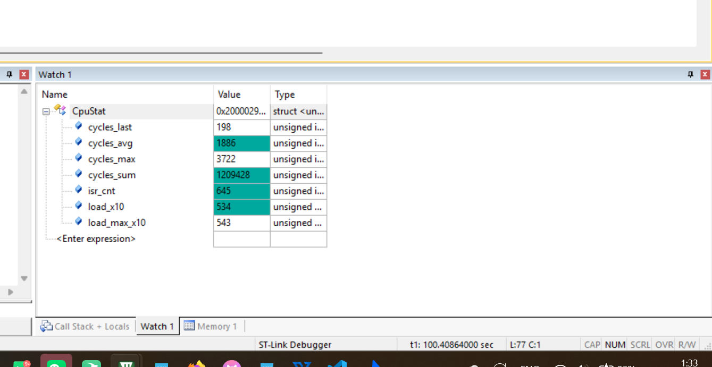
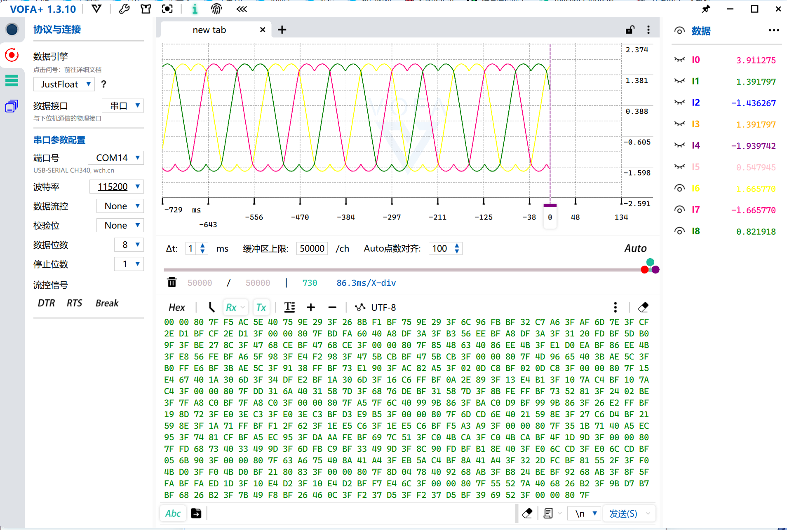

# 控制环触发架构改造：TIM4 独立定时器 → TIM1_CH4 比较中断

> 记录日期：2026-10-09
> 硬件：STM32F103（Cortex-M3，**无 FPU**），SYSCLK 72MHz
> 相关代码：`Core/Src/tim.c`、`Core/Src/stm32f1xx_it.c`、`myapp/interrupt.c`、`myapp/Hardware_Driver.c`、`myapp/test.h`、`myself_foc.ioc`
> 结论一句话：把 FOC 的触发源从"独立自由运行的 TIM4"改成"PWM 定时器自己的 CH4 比较事件"，相位由硬件锁死在载波上。中断仍是 20.408 kHz，FOC 用软件分频降到 10.204 kHz。

---

## 1. 改造前的问题：触发点在载波里一直漂

| | 计算方式 | 频率 |
|---|---|---|
| TIM1 载波（三相 PWM 输出） | 2MHz / (2×49) | 20.408 kHz（49 µs） |
| TIM4（FOC 触发） | 2MHz / (99+1) | 20.000 kHz（50 µs） |

两者都来自同一个 2 MHz 计数时钟，但 **50 : 49 互质**，所以 FOC 触发点在载波周期内的位置**每周期往后挪 1 µs**，49 个周期（2.45 ms）扫遍 49 个离散位置然后循环。

后果：**采样点相对开关沿一直在动**。开环（固定 Vq）看不出差别，但上电流环之后会采到不同纹波相位的电流 → 电流环必然抖。这是必须改的硬理由。

---

## 2. 改造内容（7 处）

| # | 文件 | 改动 |
|---|---|---|
| 1 | `Core/Src/tim.c` | TIM1 增加 CH4 通道（No Output，`Pulse=48`，中心对齐 `Period=49`） |
| 2 | `Core/Src/tim.c` | `HAL_TIM_PWM_MspInit` 里使能 NVIC `TIM1_CC_IRQn`（优先级 0，与原 TIM4 一致） |
| 3 | `Core/Src/stm32f1xx_it.c` | 新增 `TIM1_CC_IRQHandler`，DWT 测量钩子搬到这里 |
| 4 | `myapp/interrupt.c` | `HAL_TIM_PeriodElapsedCallback`(TIM4) → `HAL_TIM_PWM_PulseFinishedCallback`(TIM1/CH4) |
| 5 | `myapp/Hardware_Driver.c` | 加 `HAL_TIM_PWM_Start(CH4)` + `__HAL_TIM_ENABLE_IT(TIM_IT_CC4)`；删 `HAL_TIM_Base_Start_IT(&htim4)` |
| 6 | `myself_foc.ioc` | 同步：TIM1 Channel4 + `NVIC.TIM1_CC_IRQn`（**不改这里，CubeMX 一重新生成就全被覆盖**） |
| 7 | `myapp/test.h` | `CPU_STAT_ISR_HZ` 20000 → 20408（预算 3600 → 3528） |

---

## 3. 两个设计细节

**为什么用 CH4，而不是 TIM1 的更新中断？**
中心对齐模式下更新事件（UEV）在上溢和下溢**各产生一次**，也就是一个载波周期两次；而 CH4 比较事件位置可选、且相位固定。G431 参考工程用的也是这个做法。

**`Pulse = 48`（= ARR − 1）不是随便取的**：它让比较匹配发生在波峰前 0.5 µs，FOC 算完的 CCR 值刚好赶在下一次 UEV（占空比影子寄存器加载时刻）之前写入 → 延迟最小。

---

## 4. 频率怎么分：硬件 20.4 kHz，FOC 10.2 kHz

PWM 载波**保持 20.408 kHz 不动**（电流纹波、啸叫都不变），只把 FOC 降下来：

```c
if (++n & 1) return;                    /* 奇数拍：直接返回，什么也不干 */
Motor_StateMachine_Run(&MotorSystem);   /* 偶数拍：真正跑 FOC */
```

- 进中断 **20.408 kHz**（每次约 100 cycle，约 2.8% CPU）
- 跑 FOC **10.204 kHz**

所以 `CPU_STAT_ISR_HZ` 仍按 20.408 kHz 填——**中断频率没变**，只是一半直接 return，`load_x10` 会自动反映真实占用。

---

## 5. 实测验证





| 项 | 值 | 说明 |
|---|---|---|
| `load_x10` | **534** | 按分母 3528 反推 `1886` 一致 → **CPU 53.4%**（改前 97.7%） |
| 单次 FOC | 1886×2 − 198 = **3574 cycle** | |
| `cycles_last` | 在 **198 / 3574** 之间交替 | **软件分频在工作的直接证据**（198 = 被跳过的空转） |

### 数学没有被破坏（图 2 的 9 个通道值代数验证）

| 关系 | 验算 | 结果 |
|---|---|---|
| `Vu == Valpha` | I3 = 1.391797，I1 = 1.391797 | 逐位相同 ✓ |
| `Vu + Vv + Vw = 0` | 1.391797 − 1.939742 + 0.547945 | **0.000000** ✓ |
| 零序 `V0` | `-(max+min)/2 = 0.2739725` | |
| `Vu_Mod` | 1.391797 + 0.2739725 = 1.665770 | I6 ✓ |
| `Vv_Mod` | −1.939742 + 0.2739725 = −1.665770 | I7 ✓ |
| `Vw_Mod` | 0.547945 + 0.2739725 = 0.821918 | I8 ✓ |

架构改动后仍然是**同一控制瞬间的完美快照**，说明触发方式换了但 FOC 数学完全没动。

---

## 6. 遗留问题

1. **TIM4 成了死代码**：`main.c` 仍在调 `MX_TIM4_Init()`、`HAL_TIM_Base_MspInit` 仍使能 TIM4 的 NVIC，但外设级中断没开 → 不产生中断。以后清理时一起删。
2. **初始化顺序**：`Motor_StateMachine_Init` 里先 `Motor_Hardware_Init()`（开中断）再 `Set_Udc_Tpwm_Param()`（设参数），中间几个中断周期里参数还是 0。上电时电机没转、无净电压，**实际无害**，但建议调换顺序。
3. **Keil 编辑器编码**要设成 `UTF-8`（`Edit → Configuration → Editor → Encoding`），否则中文注释会被存成 GBK，GitHub 上显示乱码。
4. **CH4 的触发率没单独实测**：靠 `load_x10` 反推确认是每载波周期 1 次（若为 2 次则中断率 40.8 kHz、CPU 会到 108%，物理不可能）。后续如需精确确认，可在 ISR 里加计数器配合 `HAL_GetTick()` 测频率。
