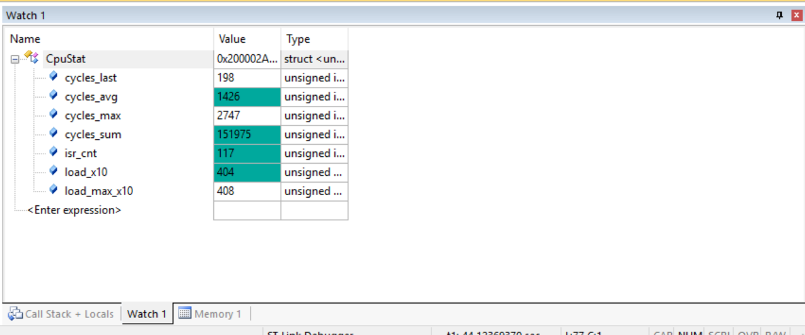

# 除法换倒数：把 SVPWM 的三次软浮点除法折成常量

> 记录日期：2026-10-09
> 硬件：STM32F103（Cortex-M3，**无 FPU**），SYSCLK 72MHz
> 相关代码：`myapp/FocAlgorithm.h`、`myapp/FocAlgorithm.c`
> 结论一句话：单次 FOC 从 **3574 降到 2654 cycle**（省 920，即 25.7%），并且 `cycles_max` 跨过 3564 这条边界，**控制延迟从 74 µs 降到 49.5 µs**。

---

## 1. 为什么盯上除法

SVPWM 每个控制周期要算三次：

```c
state->Tcmp1 = (int)(((state->Vu_Mod) / state->Udc + 0.5f) * state->Tpwm);
state->Tcmp2 = (int)(((state->Vv_Mod) / state->Udc + 0.5f) * state->Tpwm);
state->Tcmp3 = (int)(((state->Vw_Mod) / state->Udc + 0.5f) * state->Tpwm);
```

F103 没有 FPU，每个浮点运算都是一次 flash 里的库函数调用（此前实测平均约 **70 cycle**），而**除法比乘加贵得多**——贵多少，这一轮第一次量化出来了：**约 307 cycle，是普通调用的 4 倍多**（推导见第 4 节）。

而且这三次除法**除的是同一个常量 `Udc`**，本身就没有必要每周期重算。

---

## 2. 数学恒等变形

```
(Vm/Udc + 0.5) * Tpwm   ≡   Vm * (Tpwm/Udc) + 0.5 * Tpwm
```

右边只用了**一个乘法 + 一个加法**，两次运算。因为 `Tpwm/Udc` 是常量，可以预先算好存起来：

- `Kpwm = Tpwm / Udc`
- `HalfTpwm = 0.5 * Tpwm`

**整个工程只剩一次除法**，而且只在初始化（或改参数）时执行。

---

## 3. 改动（3 处）

**`myapp/FocAlgorithm.h`** —— 结构体加两个预存字段：

```c
	float Kpwm;       /* 预存 Tpwm/Udc：把每周期 3 次除法折成常量，中断里只做乘法 */
	float HalfTpwm;   /* 预存 0.5f*Tpwm：SVPWM 的直流偏置项 */
```

**`myapp/FocAlgorithm.c`** —— 初始化时算一次：

```c
	state->Kpwm     = Tpwm_temp / udc_temp;
	state->HalfTpwm = 0.5f * Tpwm_temp;
```

**`SVPWM_ZeroSqInject`** —— 每相从 4 次库调用变 3 次，除法消失：

```c
	state->Tcmp1 = (int)(state->Vu_Mod * state->Kpwm + state->HalfTpwm);
	state->Tcmp2 = (int)(state->Vv_Mod * state->Kpwm + state->HalfTpwm);
	state->Tcmp3 = (int)(state->Vw_Mod * state->Kpwm + state->HalfTpwm);
```

| 每相 | 软浮点库调用 |
|---|---|
| 改前 | `fdiv` + `fadd` + `fmul` + `f2iz` = 4 次（含 1 次除法） |
| 改后 | `fmul` + `fadd` + `f2iz` = 3 次（**0 次除法**） |

---

## 4. 实测结果



| 项 | 改前 | 改后 | 变化 |
|---|---|---|---|
| `cycles_avg` | 1886 | **1426** | −460 |
| 反推单次 FOC | 1886×2 − 198 = **3574** | 1426×2 − 198 = **2654** | **−920 cycle（−25.7%）** |
| `cycles_max` | 3722 | **2747** | −975 |
| `load_x10` | 534 | **404** | −13 个百分点 |
| CPU 占用（分母 3528） | 53.4% | **40.4%** | ✓ 与 `load_x10 = 404` 完全自洽 |

### 由实测反推：每次软浮点除法 ≈ 307 cycle

汇编统计显示这次正好少了 3 个库调用（`Foc_VoltageUpdate` 从 34 → 31，其中除法 3 → 0），所以：

```
920 cycle ÷ 3 次除法 ≈ 307 cycle/次  ≈ 4.3 µs
```

对照普通软浮点调用约 70 cycle —— **除法是它的 4 倍多**。

这个数字很有用：它把"省掉一次除法值多少"变成了可计算的量。之前只能靠估计（当时给的范围是 390~640 cycle，**实际省了 920，估计偏保守**），因为 Keil 的 armcc 软浮点库和 libgcc 是两套实现，无法离线测准。

---

## 5. 真正的收益：跨过延迟边界

这一轮最重要的收获不是省 CPU，而是**跨过了一条时间边界**。

FOC 在波峰前 0.5 µs 触发，占空比影子寄存器在下一次 UEV（更新事件）加载。中心对齐下 UEV 每个半载波一次，所以候选加载时刻是：

| FOC 耗时 | 占空比生效时刻 | 控制延迟 |
|---|---|---|
| ≤ 1800 cycle（25 µs） | 25 µs 那个 UEV | **25 µs**（要定点化才能到） |
| ≤ **3564 cycle（49.5 µs）** | **49.5 µs 那个 UEV** | **49.5 µs** |
| ~~3574 / 3722（改前）~~ | ~~74 µs 那个 UEV~~ | ~~74 µs~~ |

改前典型值 3574 **只比 3564 高了 10 拍**，就因为这 10 拍，占空比要多等一整个半载波（24.5 µs）。

改后：

| | 典型 | 最坏 |
|---|---|---|
| FOC 耗时 | **2654** | **2747** |
| 距 3564 的余量 | +910 cycle | +817 cycle |

**两个值都稳稳落在 49.5 µs 那一档 → 控制延迟降低 33%。** 控制延迟直接决定将来的电流环带宽，这比省 13 个百分点的 CPU 值钱得多。

距离 25 µs 那一档还差 **854 cycle** —— 正好是后续定点化的目标。

---

## 6. 验证

| 检查 | 结果 |
|---|---|
| 语法检查 | `FocAlgorithm.c` / `scheduler.c` / `test.c` 全 PASS |
| 汇编统计 | `Foc_VoltageUpdate` 软浮点调用 **34 → 31**，其中除法 **3 → 0** |
| 数值等价性 | 扫描 `Vu_Mod` = −2.000~2.000（4001 个点），当前参数下**最大差异 = 0 个 CCR 计数** |
| 同上，未来参数 `Tpwm=1800` | 最大差异 1 个计数 = 满量程 0.056%，可忽略 |

数值上**没有代价**，只是浮点结合律不同，而结果本来就要量化成整数计数。

---

## 7. 下一步

- **定点化**：目标把单次 FOC 压到 ≤1800 cycle，进入 25 µs 延迟档；同时给电流环腾出 CPU 余量
- **格式先定死**：标幺化 + Q15（`Kpwm` 这个改法的定点版就是 `Tcmp = HalfTpwm_int + ((Vm_q15 * Tpwm) >> 15)`，一次乘法一次移位）
- 改母线电压补偿时：`Kpwm` 改成每周期重算一次，仍然是"1 次除法换掉 3 次"
