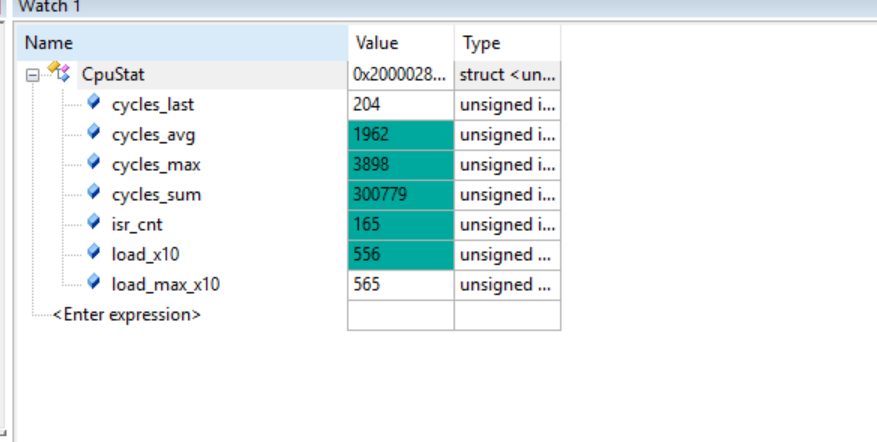
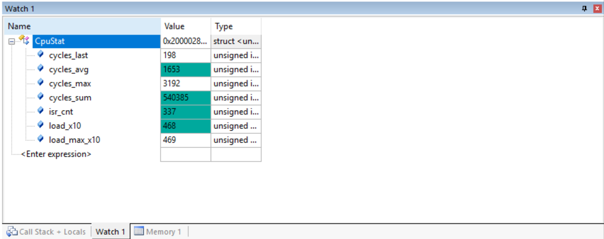
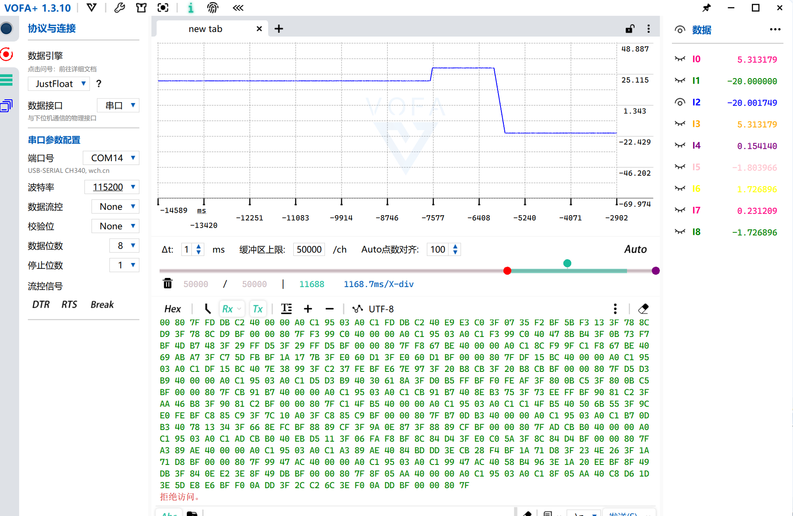

# V/F 开环速度控制（含角度回绕修正）

> 记录日期：2026-10-09
> 硬件：STM32F103（Cortex-M3，**无 FPU**），SYSCLK 72MHz
> 相关代码：`myapp/FocAlgorithm.c`、`myapp/FocAlgorithm.h`、`myapp/scheduler.c`、`myapp/scheduler.h`、`myapp/Motor_Config.h`、`myapp/Vofa.c`
> 结论一句话：用"斜坡 + 角度积分"替换了原来固定步长的角度累加，FOC 从"匀速空转"变成**可变频调速**；并修掉了角度回绕里一次**双精度 `fmod`**，CPU 占用 55.6% → **46.9%**，控制延迟回到 **49.5 µs** 档。

---

## 1. 做了什么

| # | 改动 | 文件 |
|---|---|---|
| 1 | 新增 V/F 角度生成器（结构体 + 初始化 + 周期更新） | `FocAlgorithm.h` / `FocAlgorithm.c` |
| 2 | `Motor_StateMachine_Run` 用它替换原来的 `Theta += 0.001f` | `scheduler.c` |
| 3 | `Motor_TypeDef` 增加 `Vf` 成员 | `scheduler.h` |
| 4 | 新增 `FOC_HZ = 10204` / `FOC_TS` | `Motor_Config.h` |
| 5 | **修正角度回绕**（见第 3 节）—— 本轮最值钱的一处 | `FocAlgorithm.c` |
| 6 | VOFA 通道临时改接 V/F 变量（调试用） | `Vofa.c` |

---

## 2. V/F 生成器的结构

```
速度误差 = 目标速度 − 实际速度
   ↓ 死区处理（误差小于 Dead_Zone 就当 0，防止在目标附近抖）
加速度方向 = +1 / −1 / 0
   ↓ 积分（方向 × Acc × Ts）
实际速度
   ↓ 积分（速度 × Ts）→ 即电角度
角度（回绕到 [0, 2π)）
```

| 参数 | 本次取值 | 含义 |
|---|---|---|
| `Acc` | 50 | 加速度（rad/s²） |
| `Target_Speed` | 20 → 30 → −20（实测时手动改） | 目标电角速度（rad/s） |
| `Dead_Zone` | 0.001 | 死区（rad/s） |
| `Ts` | 1/10204 ≈ 98 µs | 步长（= 1/FOC 频率）|

**电压那一路没动**，仍是 `Vd = 0, Vq = 2.0` 恒定：V/F 生成的旋转角度送进原有的
`反Park → 反Clark → 零序注入 SVPWM → Tcmp` 通路，所以输出的是**旋转的电压空间矢量**，
频率由 `Vf.Speed` 决定、幅值固定 2 V。

> ⚠️ 严格说这叫"**恒压变频**"而不是 V/F。真正的 V/F 要 `幅值 = V_boost + K_vf × 频率`
> 并限幅在 `Udc/√3 = 6.93 V` 以内。这一步还没做，见第 6 节。

---

## 3. 关键修正：角度回绕（原来只回绕"输出"）

**原来的写法**：

```c
state->Theta_Integrator += state->Speed_Integrator * state->Ts;
state->Theta = fmod(state->Theta_Integrator, ANGLE_2PI);   /* 只回绕输出 */
if (state->Theta < 0) state->Theta += ANGLE_2PI;
```

累加器 `Theta_Integrator` 自己**永远在涨**，两个后果：

**① 每周期一次双精度 `fmod`。** `ANGLE_2PI` 是 float、参数被提升成 double，所以汇编里是
`__aeabi_f2d` + `fmod`(double) + `__aeabi_d2f` 三次调用。实测**约 612 cycle（≈8.5 µs）**。

**② float 精度随累加值退化。**

| `Theta_Integrator` | 角度分辨率 | 相当于 |
|---|---|---|
| 200 rad（跑 10 秒） | 1.2e-5 rad | 0.0007° |
| 2.8e4 rad（跑 23 分钟） | 1.7e-3 rad | 0.096° |
| 2.8e5 rad（跑 4 小时） | 1.7e-2 rad | **0.96°** ✗ 波形出现台阶 |

**改成回绕累加器本身**：

```c
state->Theta_Integrator += state->Speed_Integrator * state->Ts;

if (state->Theta_Integrator >= ANGLE_2PI)      state->Theta_Integrator -= ANGLE_2PI;
else if (state->Theta_Integrator < 0.0f)       state->Theta_Integrator += ANGLE_2PI;

state->Theta = state->Theta_Integrator;        /* 已在 [0,2π)，直接就是输出 */
```

三个设计点：

- **正负都要判**：速度可负（反转），那时累加器往负方向走，需要 `+= 2π` 那一支
- **用 `if` 不用 `while`**：单次增量是 `Speed × Ts` ≈ 0.002 rad，远小于 2π，一次减法足够；
  而且万一速度变成 `inf`/`NaN`，`while` 会**死循环卡在中断里**，`if` 顶多这一拍算错
- **回绕后累加器永远小于 6.29**，精度恒定在 float 极限（约 2e-7 rad），跑整夜也不变

汇编验证：`f2d` / `fmod` / `d2f` 三次双精度调用**全部消失**，只剩 13 次 float 级调用。

---

## 4. 实测数据





| 指标 | V/F 之前 | 引入 V/F | **回绕修正后** |
|---|---|---|---|
| `cycles_avg` | 1426 | 1962 | **1653** |
| 单次 FOC（avg×2 − 198） | 2654 | 3720 | **3108** |
| `cycles_max` | 2747 | 3898 | **3192** |
| `load_x10` | 404 | 556 | **468** |
| CPU 占用（分母 3528） | 40.4% | 55.6% | **46.9%** |
| 控制延迟档 | 49.5 µs | 74 µs ✗ | **49.5 µs** ✓ |

拆开看两笔账：

```
V/F 净开销        = 1066 → 454 cycle   （斜坡数学本身）
双精度 fmod 那条链 = 612 cycle          （纯浪费，已删）
```

**V/F 只花 454 cycle（占中断预算 13%）就换来一个完整的开环调速器**，很划算；
而那次 `fmod` 白花了 612 cycle，去掉它顺带把延迟档从 74 µs 拉回 49.5 µs。

### VOFA 调速实测



通道临时改接成 `[1]=Target_Speed [2]=Speed [3]=Vf.Theta`，读数：

| 通道 | 值 | 说明 |
|---|---|---|
| I1 目标速度 | −20.000000 | 目标 −20 |
| I2 实际速度 | **−20.001749** | 误差 0.0017，落在死区（0.001 + 每拍步进 0.0049）内 ✓ |
| I3 `Vf.Theta` | **5.313179** | **< 2π = 6.2832 → 回绕生效** ✓ 这是修正的唯一判据 |
| I0 `Foc.Theta` | 5.313179 | 与 I3 **完全相同** ✓ 输出链路正确 |

角度从 20 → 30 → −20 三次改目标，波形呈现"平台 → 斜坡下降 → 稳定在负值"，**斜坡与反转都正常**。

**顺带用 I0 的角度回算了整条 FOC 链**（θ = 5.313179 rad = 304.4°）：

| 量 | 按代码重算 | 实测 | 一致 |
|---|---|---|---|
| `Vv` | 0.15530 | I4 = 0.154140 | ✓ |
| `Vw` | −1.80446 | I5 = −1.803966 | ✓ |
| `Vu_Mod` | 1.72681 | I6 = **1.726896** | ✓ |
| `Vw_Mod` | −1.72681 | I8 = **−1.726896** | ✓ |

吻合到 1e-3 量级（残差来自读取撕裂：9 个通道不是同一瞬间读的，而角度正以 20 rad/s 转动）
→ **V/F 接进 FOC 通路后数学没有被破坏。**

---

## 5. 一个方法论收获：数库调用次数会低估收益

这次修正的汇编对比很反直觉：

| | 改前 | 改后 |
|---|---|---|
| `Vf_SpeedControl_Update` 的库调用次数 | 14 | **13**（只少 1 次）|
| 实测节省 | | **612 cycle** |

原因：删掉的是 `f2d`/`fmod`/`d2f` 三个**双精度**例程，而加回来的是 `fsub`/`fcmpge` 两个 float 级的。
"平均 70 cycle/次"这个经验值**完全不适用于双精度例程**。

**所以只有 DWT 实测是准的**——按调用次数估算会得出"只优化了 7%"的错误结论。

---

## 6. 遗留与下一步

**① 电压幅值律还没做（唯一的功能缺口）**

```c
state->Foc.Vq = 2.0f;      /* 恒定，不跟频率走 */
```

频率升高后反电动势变大，2 V 会不够 → 失步。需要：

```c
float f_elec = state->Vf.Speed * (1.0f / ANGLE_2PI);   /* 电频率 Hz */
state->Foc.Vq = V_BOOST + K_VF * f_elec;
if (state->Foc.Vq > V_MAX) state->Foc.Vq = V_MAX;      /* V_MAX ≤ Udc/√3 = 6.93 V */
```

`V_BOOST`/`K_VF` 必须**实测标定**：限流电源从低频慢慢升，找"不失步、电流又小"的一组值。
本平台**没有电流采样也没有位置反馈**，只能靠听声音 + 看电流表 + 看 VOFA 波形判断失步。

**② VOFA 通道是临时的**

`Vofa.c` 里 `[1][2][3]` 现在发的是 V/F 变量，`Valpha`/`Vbeta`/`Vu` 不再发送。
调完 V/F 建议还原（或扩到 12~16 通道两套都发）——因为附录 A 那种代数交叉验证
依赖 `Vu == Valpha` 和 `Vu+Vv+Vw = 0` 这两个不变量，缺了就没法自查。

**③ V/F 斜坡跑在中断里**

斜坡是慢变量（几百毫秒才变一点），却占着 10 kHz 中断的 454 cycle。更合理的分工是：
**斜坡放主循环**（100~1000 Hz 足够）、**中断里只做角度累加**（1 次整数加法）。
这正好是定点化的第一步——角度本就是 uint16 定点，回绕天然免费。

**④ 两处死代码**：`scheduler.c` 里 13 行旧角度代码注释、`sincos.h:21` 的
`Foc_Sin_U16` 声明（只有声明、无定义、无人调用）。
