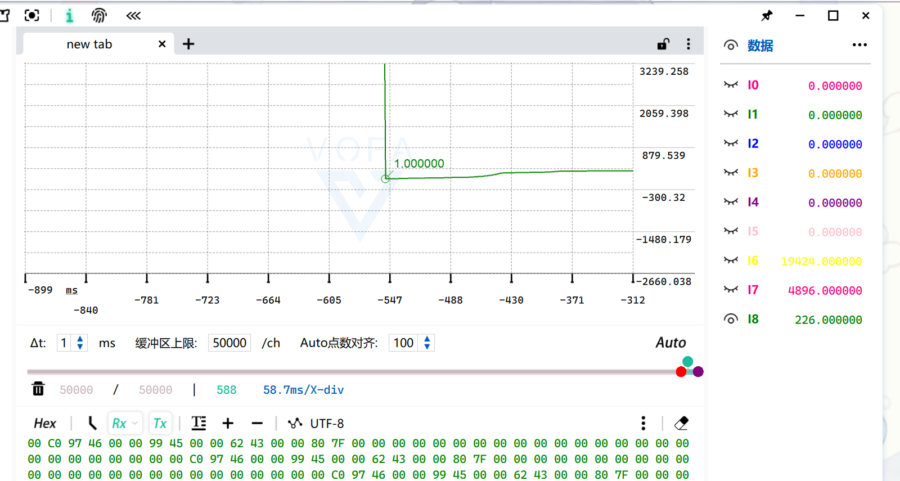
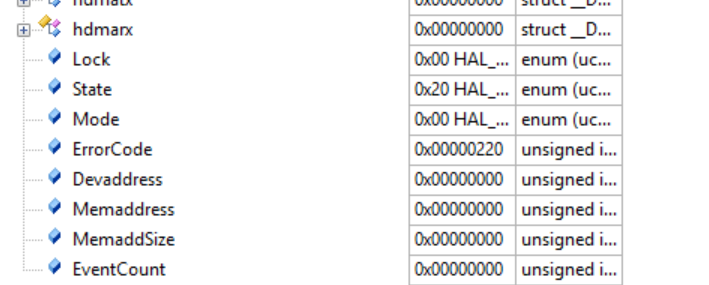
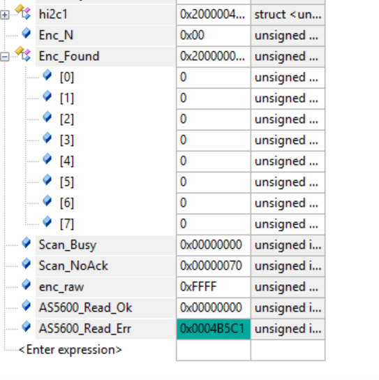
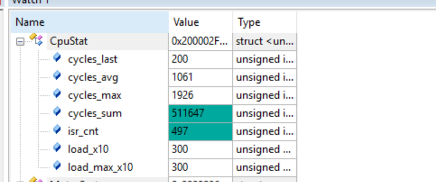

# AS5600 编码器接入（含 I2C 排障与零点标定）

> 记录日期：2026-10-09
> 硬件：STM32F103（Cortex-M3，**无 FPU**），72MHz；AS5600 磁编码器（12 位）走 I2C1 重映射到 PB8/PB9
> 相关代码：`myapp/Encoder.c/.h`（新建）、`myapp/Hardware_Driver.c/.h`、`myapp/bsp_system.h`、`myapp/scheduler.c/.h`、`myapp/Motor_Config.h`、`Core/Src/main.c`、`myapp/Vofa.c`
> 结论一句话：按 G431 工程的分工接入编码器（**读原始值放 Hardware_Driver，角度换算放 Encoder**），
> 中途一颗**坏芯片**引起的 I2C 假象耽误了好几轮；换芯片后 `Read_Err = 0`，编码器链路与零点标定全部验证通过。

---

## 1. 三步走的第一、二步

| 步 | 内容 | 状态 |
|---|---|---|
| ① | 接入编码器，用 VOFA / Watch 看数据 | ✅ 完成 |
| ② | 零点标定 | ✅ 完成（`Phase = 3108`）|
| ③ | 接闭环 | 未开始 |

---

## 2. 代码结构（照 G431 的分工）

| G431 工程 | 本工程 |
|---|---|
| `Encoder.h/.c`：`Encoder_Typedef` + `Encoder_Param_Init` + `Encoder_UpData` | **同名同字段**（只把 `float Theta/Theta_e` 换成定点的 `Theta_U16/Theta_e_U16`）|
| `Hardware_Driver.c`：`MT6701_ReadData()` | `AS5600_ReadData()` ✓ |
| `Motor_Config.h`：`ENCODER_LINE` / `Pn` | **同名**（4096 / 7）|
| `bsp_system.h` include `spi.h` + `Encoder.h` | include `i2c.h` + `Encoder.h` |
| `StateMachine.h` 里显式 include `Encoder.h` | `scheduler.h` 同样处理 |

**为什么 G431 的 `Encoder.c` 只有一个函数**：因为"读传感器"在 `Hardware_Driver.c` 里，
`Encoder.c` 只做角度换算 ✓ 所以本工程也只有两个函数 ✓

### 关键换算（全程整数，零浮点）

```c
uint32_t Temp = (state->Pulse_Data + state->Line - state->Phase) % state->Line;
state->Theta_U16   = (uint16_t)(((uint32_t)Temp << 16) / state->Line);   /* 12位 -> uint16 一圈 */
state->Theta_e_U16 = (uint16_t)((uint32_t)state->Theta_U16 * state->MotorPn);  /* 溢出即回绕 */
```

为什么不用 G431 的浮点写法：

| | G431 的写法 | 本工程 |
|---|---|---|
| 机械角 | `(float)Temp / Line * 2π` | 一次整数除法 + 移位 |
| 电角度 | `fmod(Theta * Pn, 2π)` | **一次整数乘法**（uint16 溢出天然回绕）|
| **实测代价** | **约 1100 cycle**（浮点除法 307 + 双精度 fmod 612）| **约 30 cycle** |

而 AS5600 是 12 位，`4096 × 16 = 65536` —— **一个 bit 都不浪费** ✓

---

## 3. 实测验证

### 上电自检（换芯片后）

![图 1　换芯片后的地址扫描：Enc_N = 1，Enc_Found[0] = 0x36，Read_Err = 0](img/01-换芯片后扫描成功-0x36.png)

```
Enc_N     = 1            ← 总线上有 1 个器件
Enc_Found[0] = 0x36      ← AS5600 的正确地址（确认 12 位，ENCODER_LINE 4096 对）
Scan_Busy = 0            ← 总线正常释放
Scan_NoAck= 111          ← 112 - 1 = 111，自洽
enc_raw   = 0x0602=1538  ← 真实角度值
Read_Ok   = 265423，Read_Err = 0     ← ★ 零失败 ★
```

### 角度链路（用 VOFA 三次交叉验证）

```
Theta_e_U16 应该 = Theta_U16 × 7 mod 65536

24608 × 7 = 172256 → mod 65536 = 41184  ✓（实测 41184）
57184 × 7 = 400288 → mod 65536 = 7072   ✓（实测 7072）
19424 × 7 = 135968 → mod 65536 = 4896   ✓（实测 4896）
```

**手转一圈 = 7 个电周期** ✓ → **`Pn = 7` 实测确认**（原来是占位猜测值）

### 标定后的原始值波形



---

## 4. 排障过程（这一段最值钱）

### 症状

```
Pulse_Data = 0x0000FFFF  恒不变      → 读失败
Theta_e_U16 = 65424      恒不变      → 角度是假的
hi2c1.ErrorCode: 一会 0x00，一会 0x04，一会 0x220
```

### 三个把人带偏的假象

**① `ErrorCode = 0x00` 不等于成功** ✗

`HAL_I2C_Mem_Read` 的开头（本工程源码 `stm32f1xx_hal_i2c.c:2693`）：

```c
if (hi2c->State == HAL_I2C_STATE_READY)
{
  /* Wait until BUSY flag is reset */
  if (I2C_WaitOnFlagUntilTimeout(hi2c, I2C_FLAG_BUSY, SET, ...) != HAL_OK)
  {
    return HAL_BUSY;              /* ← 直接返回！ErrorCode 一个字都没动 */
  }
  ...
  hi2c->ErrorCode = HAL_I2C_ERROR_NONE;   /* ← 只有走到这里才会被清零重算 */
```

**总线上卡着的时候它直接 `return HAL_BUSY`，`ErrorCode` 保持上一次的值** ✗
所以"一会 0x00 一会 0x04"里那个 0x00 **什么也不代表** ✗ —— 我们被它误导了好几轮。

**② `0x220` = `WRONG_START` + `TIMEOUT`**（源码 `:3569`）

```c
SET_BIT(hi2c->Instance->CR1, I2C_CR1_START);          /* 发出 START */
if (I2C_WaitOnFlagUntilTimeout(hi2c, I2C_FLAG_SB, RESET, ...) != HAL_OK)
{
  if (READ_BIT(hi2c->Instance->CR1, I2C_CR1_START) == I2C_CR1_START)
    hi2c->ErrorCode = HAL_I2C_WRONG_START;             /* ← 0x200 */
```

含义是"**我想发起始条件，但总线没释放**" → 物理层被拉死 ✓



**③ 总线浮空的"全 1"数据会伪装成合法角度** ✗✗

```
rx[0] = 0xFF, rx[1] = 0xFF  →  (0xFF & 0x0F) << 8 | 0xFF  =  0x0FFF = 4095
                            →  Theta_U16 = 4095 × 16 = 65520
                            →  Theta_e_U16 = 65520 × 7 mod 65536 = 65424   ← 和"读失败"的输出一模一样！
```

也就是说：**读失败（返回 0xFFFF）** 和 **读成功但数据全 1**，算出来的角度**完全相同** ✗
屏幕上根本无法区分 ✓ 这个坑直接导致"为什么数值一直不变"的困惑 ✓

### 真正定位问题的手段：地址扫描 + 失败分类计数



```
Scan_Busy  = 0      ← 总线每次都正常释放（上拉没问题）
Scan_NoAck = 112    ← 112 个合法地址全都"发出去了、没人应答"
Enc_N      = 0
```

**这一对数一步就把范围劈开了**：

| `Scan_Busy` | `Scan_NoAck` | 结论 |
|---|---|---|
| ≈112 | ≈0 | 总线被拉死 → 纯硬件（上拉/短路/没供电）|
| **≈0** | **≈112** | **总线是通的，只是没有器件应答 → 芯片侧问题** |
| `Enc_N ≥ 1` | | 找到器件，地址就是答案 |

由此排除了：上拉、MCU 的 I2C 配置与重映射、驱动/协议、地址写错 ✗
**只剩：芯片供电 / 连线 / 接反 / 芯片坏** ✓ 最后确认是 **芯片坏了** ✓

### 修复

换芯片 → 立刻 `Enc_N = 1`、`Enc_Found[0] = 0x36`、`Read_Err = 0` ✓
（换之前 `Read_Err = 0x4B5C1 = 308673` 次失败）

---

## 5. 零点标定

### 方法（d 轴对齐法）

```
① 目标速度 0        → V/F 角度锁死在 0（不需要写任何"模式切换"代码）
② Vd = 3.0, Vq = 0  → 电压矢量固定在 α 轴，转子被吸过去
③ 读 Pulse_Data     → 这个原始计数就是 Phase
④ Phase 填回去      → 被吸住的位置电角度正好 = 0
⑤ Vd = 0, Vq = 2.0  → 改回运行用的 q 轴出力
```

### ⚠️ 两个必须记住的坑

**坑一：标定必须用 `Vd`（d 轴），不能用 `Vq`** ✗

| 标定设置 | θ=0 时矢量指向 | 标出来的"θ=0"含义 | 运行时（Vd=0,Vq=A）矢量落在 |
|---|---|---|---|
| **Vd=A, Vq=0** ✓ | +α | **d 轴在 α** ✓ 标准定义 | θ+90° = **q 轴 → 有转矩** ✓ |
| Vd=0, Vq=A ✗ | +β | d 轴在 β ✗ | θ+90° = **d 轴 → 零转矩，电机不转** ✗✗ |

**坑二：`Phase` 的单位是"原始计数"（0~4095）** ✗

```c
Temp = (state->Pulse_Data + state->Line - state->Phase) % state->Line;
                  ↑ 原始计数                          ↑ 所以必须也是原始计数
```

| 通道 | 单位 | 能当 Phase 吗 |
|---|---|---|
| `Pulse_Data` | 0 ~ 4095 | ✓ **只有这个** |
| `Theta_U16` | 原始值 × 16 | ✗ 差 16 倍 |
| `Theta_e_U16` | ×16 再 ×7 **且回绕过** | ✗ 差 112 倍，不可逆 |

**实战教训**：一开始错填了 `Theta_e_U16 = 22368` ✗
反推：`22368 = raw × 112 mod 65536` → `raw = 1370` ✓ 验证 `1370×16×7 mod 65536 = 22368` ✓
（所以能反推，但远不如**直接读 `Pulse_Data`** 省事 ✓）

### 一个容易被误会的现象：Pn=7 有 7 个等效吸附位置

```
3108 - 1370 = 1738 ≈ 3 × 585        （585 = 4096 ÷ 7，正好一个电周期）
```

转子有 7 对磁极，定子磁场只有一对 → **每转 51.43°（585 个计数）磁路完全重合** ✓
所以每次上电吸住的位置可能落在**不同槽** ✗ → `Phase` 的机械值会差 585 的整数倍 ✓
**电气上完全等价** ✓ 不必纠结 ✓

### 最终值

```c
Encoder_Param_Init(&state->Encoder, ENCODER_LINE, 0, Pn, 3108);
/*                                                  ↑ Phase，原始计数 */
```

---

## 6. I2C 速率与限频（CPU 账）

| I2C 速率 | 一次 2 字节读 | 主循环"每圈都读" | **限频 1kHz** |
|---|---|---|---|
| 100 kHz | 0.49 ms | 吃光主循环 ✗ | 49% ✗ |
| **400 kHz** | **0.12 ms** | 吃光主循环 ✗ | **12%** ✓ |

**关键认识**：阻塞式读的 CPU 占用 ≈ 100%（读的时候 CPU 全在等标志位 ✗）
**只有"限频"能真正解决** ✓ —— 光提高 I2C 速率没用（循环会跟着变快、读的次数也变多 ✗）

```c
/* 主循环：限频到 1kHz */
static uint32_t enc_tick = 0;
if((HAL_GetTick() - enc_tick) >= 1U)
{
    enc_tick = HAL_GetTick();
    uint16_t data = AS5600_ReadData();
    if(data != 0xFFFF) { Encoder_UpData(&MotorSystem.Encoder,data); }
}
```

### 一个硬限制（决定第三步怎么做）

> **即使 400 kHz，编码器读也永远不能放进 FOC 中断** ✗

读一次 **0.12 ms > FOC 周期 0.098 ms** ✗ 放进去直接漏拍 ✓

**推论**：电角度只能在主循环以 1 kHz 级别更新 ✗
将来要让 10 kHz 的 FOC 用上它，**必须做角度锁相环（PLL / 跟踪观测器）** ✓

### 中断占用实测



| 指标 | 之前 | 之后 |
|---|---|---|
| `cycles_avg` | 1653 | **1061** |
| 单次 FOC | 3108 | **1922 cycle** |
| `cycles_max` | 3192 | **1926** |
| `load_x10` | 469 | **300（30.0%）** |

⚠️ **`CpuStat` 只测中断** ✗ —— 限频改的是**主循环**，所以这 30% **不是限频的直接效果** ✓
（它变化说明取指/代码状态变了：F1 在 72MHz 下有 2 个 flash 等待周期 + 预取缓冲 ✓）

**一个有价值的目标**：`cycles_max = 1926`，而"25 µs 延迟档"的边界是 **1800 cycle**
→ **只差 126 cycle（1.75 µs）** ✓ 再省一点就能把执行器延迟从 49.5 µs 砍到 25 µs ✓
（对开环 V/F 无所谓，上电流环时才有意义 ✓）

---

## 7. 遗留与下一步

**① 两件没做的小事**

- 磁铁自检 `AS5600_CheckMagnet(&agc)` → 期望返回 0、AGC 约 128
- 方向确认：正转时 `Theta_U16` 应上升，否则 `Dir` 改 1

**② 第三步：接闭环**

- 先做**电压型 FOC + 编码器电角度**（对应 G431 的 `THETA_MODE_ENCODER`）
- 需要加 `Theta_Mode` 三档切换（ZERO / VF / ENCODER），照 G431 的结构
- 起步无力 / 被吸住不转 → 检查 `Phase` 是否差 180°（±293 个计数，即半个电周期）

**③ 高速与电流环的前提**

1 kHz 的角度更新在 20 rad/s 时滞后 1.1° ✓，到 100 rad/s 就是 5.7° ⚠️
→ **角度锁相环（PLL）是把低速率绝对角度补成 10 kHz 平滑角度的标准做法** ✓

**④ 已清理**：`myapp/AS5600.c/.h`（早期版本的废弃空壳，未加入 Keil 工程）已在本提交中删除 ✓
