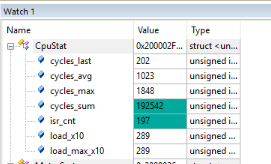
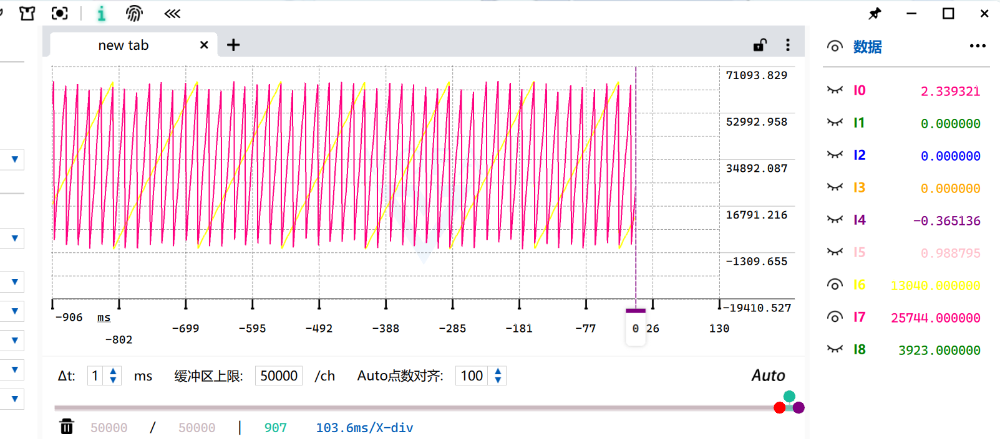
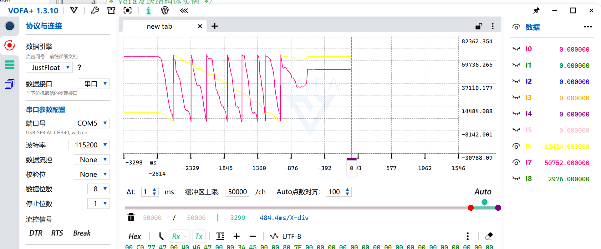

# 角度刻度统一（定点化）与编码器闭环接入

> 记录日期：2026-10-09
> 硬件：STM32F103（Cortex-M3，**无 FPU**），72MHz；AS5600（12 位，I2C @400kHz，1kHz 读取）
> 相关代码：`myapp/FocAlgorithm.c/.h`、`myapp/scheduler.c/.h`、`myapp/key_app.c`、`myapp/Vofa.c`
> 结论一句话：把 V/F 与编码器两路角度**统一成"一圈 = 65536"的整数刻度**（V/F 改用 uint32 Q16 累加器，
> 回绕靠溢出自动完成），于是第三步"切角度源"变成**一行赋值**；顺带省了 **78 cycle/次 FOC**。

---

## 1. 三步走完成 ✅

| 步 | 内容 | 状态 |
|---|---|---|
| ① | 接入编码器看数据 | ✅ |
| ② | 零点标定（`Phase = 3108`）| ✅ |
| ③ | **接闭环（电压型 FOC + 编码器电角度）** | ✅ 本次完成 |

---

## 2. 改动一：角度路径定点化

### 为什么要改

改之前**两路角度是两套刻度** ✗：

| 变量 | 单位 | 范围 |
|---|---|---|
| `Foc.Theta` / `Vf.Theta` | **弧度** ✗ | 0 ~ 6.28 |
| `Foc.Theta_U16` / `Encoder.Theta_e_U16` | 计数 ✓ | 0 ~ 65535 |

→ 切角度源时必须经过 `ANGLE_FROM_RAD` 软浮点转换（约 70 cycle，而且是在中断里 ✗）

### 怎么改

**V/F 角度积分：浮点弧度 + if/else 回绕 → uint32 Q16 累加 + 溢出回绕**

```c
/* FocAlgorithm.h */
#define ANGLE_Q16_PER_RAD  (683565000.0f)     /* 65536/2π × 65536 */

/* 结构体 */
float    Step_K;            /* 初始化算一次：Ts × ANGLE_Q16_PER_RAD */
uint32_t Theta_Acc_Q16;     /* 高 16 位就是 uint16 角度 */
uint16_t Theta_U16;         /* 输出：一圈 = 65536 */

/* Param_Init */
state->Step_K = ts * ANGLE_Q16_PER_RAD;

/* Update —— 替代原来的「浮点积分 + 两次浮点比较回绕」*/
state->Theta_Acc_Q16 += (uint32_t)(int32_t)(state->Speed_Integrator * state->Step_K);
state->Theta_U16      = (uint16_t)(state->Theta_Acc_Q16 >> 16);
*Target_Theta_U16     = state->Theta_U16;
```

**三个好处**：

1. **回绕零成本**：uint32 溢出自动完成，不需要 `if/else` ✓ 也不可能因 `inf/NaN` 死循环 ✓
2. **正反转都对**：负步长走补码回绕（步长 −30.7 → 角度 65536−30.7 ✓）
3. **刻度与编码器一致** → 切角度源变成**一行赋值** ✓✓

### 汇编验证

| | V/F 函数的软浮点调用数 |
|---|---|
| 最初（带双精度 fmod）| 13 |
| 记录 04 修掉 fmod 后 | 11 |
| **本次定点化后** | **9** ✓（回绕的两处浮点比较消失）|

角度路径现在只剩：`f2iz`（步长转整数）→ **整数加** → **右移 16 位** ✓

### 实测（DWT）



| 指标 | 改前 | 改后 |
|---|---|---|
| `cycles_avg` | 1061 | **1023** |
| 反推单次 FOC | 1922 | **1844**（**省 78 cycle**）|
| `cycles_max` | 1926 | **1848** |
| `load_x10` | 300 | **289** |

⚠️ **诚实记录**：事先估算"省 150~280 cycle"✗，**实测只有 78** ✓
又一次印证记录 04 的教训 —— **按调用次数估算会高估，只有 DWT 实测可信** ✓

⚠️ **还没跨过延迟档边界**：`24.5 µs = 1764 cycle`，实测 1848 ✗ **还差 84 cycle**
→ 执行器延迟仍是 49.5 µs（不是预期的 25 µs）✓ 但对开环 V/F 和速度环都无所谓 ✓

**下一个大目标**（将来上电流环时再做）：`SVPWM_ZeroSqInject` 里还有 **21 次**软浮点调用，
是最大头 → **把反 Park / 反 Clark / SVPWM 改成 Q15 定点**，预期能省几百 cycle ✓

---

## 3. 改动二：`Theta_Mode` 三档 + 编码器闭环

### 结构（照 G431 工程）

```c
typedef enum
{
	THETA_MODE_ZERO = 0,     /* 固定角度零度（定位）*/
	THETA_MODE_VF,           /* V/F 角度自增 */
	THETA_MODE_ENCODER,      /* 编码器电角度 */
}MotorThetaMode_Enum;
```

```c
	switch(state->Theta_Mode)
	{
		case THETA_MODE_ZERO:
			state->Foc.Theta_U16 = 0;
		break;
		case THETA_MODE_VF:
			Vf_SpeedControl_Update(&state->Vf,&state->Foc.Theta_U16);
		break;
		case THETA_MODE_ENCODER:
			state->Foc.Theta_U16 = state->Encoder.Theta_e_U16;   /* ★ 就这一行 ★ */
		break;
		default:
		break;
	}
```

**这就是刻度统一的价值** ✓：两路角度都是"一圈 = 65536"，切角度源**零转换** ✓

### 按键（照 G431）

| 键 | 作用 |
|---|---|
| **KEY1** | 循环切换 `Theta_Mode`：ZERO → VF → ENCODER → ZERO |
| **KEY2** | 切 `Vd`：0 ↔ 1.0 V（d 轴对齐用）|
| **KEY3** | 切 `Vq`：0 ↔ 1.0 V（**给转矩，电机才会转**）|

### ⚠️ 踩的两个坑（值得记）

**坑一：改角度前必须确认"FOC 到底读哪个字段"** ✗✗

```c
/* FocAlgorithm.c:16 —— FOC 反 Park 实际用的是这个 */
Foc_SinCos_U16(state->Theta_U16, &s, &c);
                 ^^^^^^^^^^^^^ 只有它有用
```

一开始把编码器角度写进了 `Foc.Theta`（**float**）✗：

```c
case THETA_MODE_ENCODER:
	state->Foc.Theta = state->Encoder.Theta_e_U16;   /* ✗ 类型错 + 字段错 */
```

后果：① uint16 的 50752 被当成 50752.0 弧度（垃圾值）② **`Theta_U16` 根本没更新**
→ FOC 查表用的还是 V/F 上次留下的角度 → **切到编码器模式后角度直接冻住，电机被吸住不动** ✗

**教训**：`Foc_TypeDef` 里同时有 `float Theta` 和 `uint16_t Theta_U16`，
`float Theta` 现在**完全没人读**（VOFA 显示也是从 `Theta_U16` 现算的）→ 改角度一律改 `Theta_U16` ✓

**坑二：`Vd/Vq` 每周期被覆写 → 按键无效** ✗

```c
/* 原来在 Motor_StateMachine_Run 里，每个 FOC 周期都执行 */
state->Foc.Vd = 0.0f;
state->Foc.Vq = 0.0f;      /* ✗ 按键刚改完就被覆盖 */
```

→ 把 `Vd/Vq` 从"每周期常量"改成"**状态量**"：在初始化里设一次，之后由按键修改 ✓

**坑三：上电必须初始化 `Theta_Mode`** ✗

不初始化时默认值 0 = `THETA_MODE_ZERO` → **一上电就被固定矢量吸住不动** ✗
（调试器里手动改参数测试时发现不了这个问题 ✓ 但脱机重新上电就复现 ✗）

```c
	state->Theta_Mode = THETA_MODE_VF;   /* 上电默认跑 V/F */
	state->Foc.Vd = 0.0f;
	state->Foc.Vq = 0.0f;                /* 安全：上电不转，按 KEY3 才给转矩 */
```

### 实测波形（Vq = 1V，编码器模式）



黄色 = `Encoder.Theta_U16`（机械角），粉色 = `Encoder.Theta_e_U16`（电角度）
**一圈机械角对应 7 个电角度锯齿** ✓ → `Pn = 7` 再次确认 ✓

**三个模式实测都能用，按键正常** ✓ 编码器闭环下电机正常转动 ✓

---

## 4. 实测验证：一帧数据把整条链路验证死

用 VOFA 面板 + 底部 hex 帧里的三个数做完整验算：

```
Pulse_Data = 2976，Phase = 3108（标定值）
  → Temp        = (2976 + 4096 − 3108) % 4096 = 3964
  → Theta_U16   = 3964 × 16           = 63424   ✓ 与面板一致
  → Theta_e_U16 = 63424 × 7 mod 65536 = 50752   ✓ 与面板一致
```

**三个数严格自洽** ✓✓ 说明：

- 编码器读取 ✓
- `Phase` 零点标定 ✓
- `×16`（12 位 → uint16）与 `×7`（机械 → 电角度）换算 ✓



---

## 5. 遗留与下一步

**① 延迟档还差 84 cycle**

`cycles_max = 1848`，边界 `1764`（24.5 µs）→ 想拿 25 µs 档要再做 **FOC 定点化（Q15）** ✓

**② 高速下的角度新鲜度**

现在角度 1 kHz 更新：20 rad/s 时滞后 1.1° ✓，100 rad/s 时 5.7° ⚠️
→ 想上高速/电流环，需要**角度锁相环（PLL / 跟踪观测器）** ✓

**③ 待清理**

- `Foc_TypeDef.Theta`（float）已无人读，可以删
- `scheduler.c` 里还留着几行注释掉的旧角度代码

**④ 标定若差 180°**

切到 ENCODER 后如果**起步无力 / 被吸住不转** → `Phase` 加或减 **293**
（半个电周期 = 4096 ÷ 7 ÷ 2 ≈ 293 ✓）
