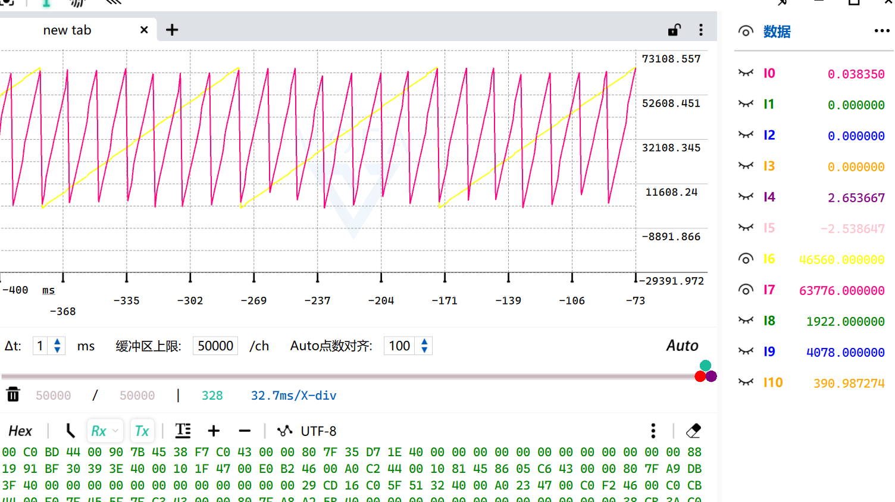
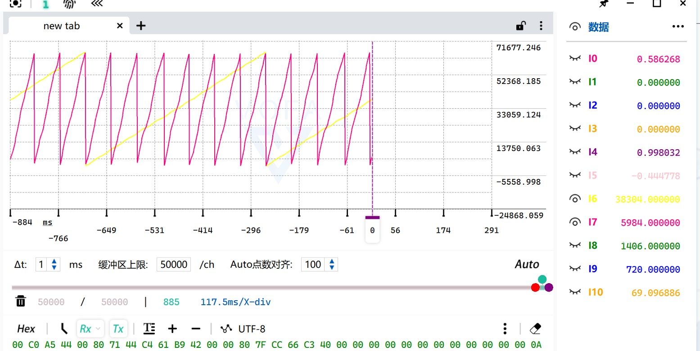
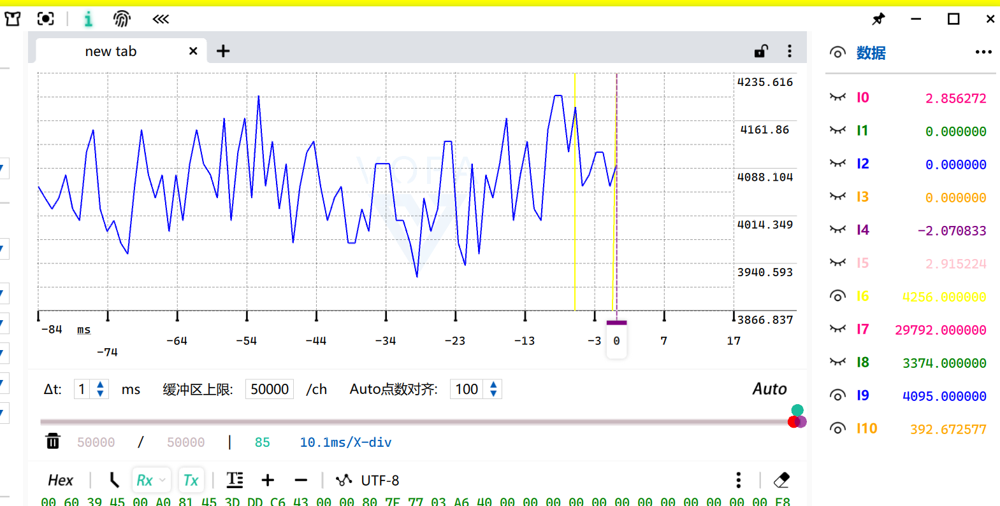
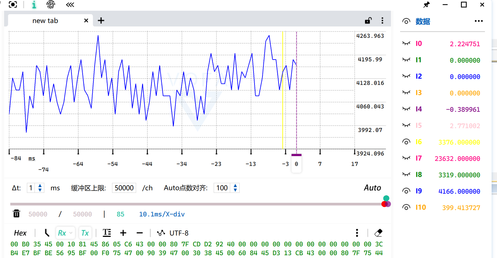

# 编码器角度预测（时间戳 + 实测转速）

> 记录日期：2026-10-09
> 硬件：STM32F103（72MHz）、AS5600（12 位，I2C @400kHz，主循环 1kHz 读取）、FOC 10.204kHz
> 相关代码：`myapp/Encoder.c/.h`（主要改动）、`myapp/scheduler.c`、`Core/Src/main.c`、`myapp/Vofa.c/.h`、`myapp/Motor_Config.h`
> 结论一句话：编码器 1kHz 采样、FOC 10kHz 控制，两次采样之间角度是"冻住"的 —— 用 **DWT 时间戳 + 实测转速**把角度推到"本拍电压实际生效的时刻"。
> **实现正确且已验证** ✓，但**开环下收益天生很小（540rpm 只有 2~3%）** ✓ 它真正的价值在**速度估计**和**将来闭环的相位裕度**。

---

## 1. 问题：两次采样之间，角度是冻住的

```
AS5600 一次读 0.12ms（400kHz）> FOC 周期 0.098ms
→ 编码器读取永远进不了 FOC 中断
→ 角度只能 1kHz 更新，两次采样之间"零阶保持"
```

**滞后量化**：

$$\Delta\theta_e[^\circ] = 6 \cdot p \cdot n \cdot \Delta t \qquad (p=\text{极对数},\ n=\text{rpm},\ \Delta t=\text{秒})$$

| 转速 | 1ms 滞后 | 平均转矩损失 |
|---|---|---|
| 129 rpm | 5.4° | 0.4% |
| **540 rpm** | **22.7°** | **2.6%** |
| 1200 rpm | 50° | 12% |
| 3000 rpm | 126° | 43% |

（平均损失 = `1 - sin(Δθ)/Δθ`，因为一个周期内错位从 0 线性长到 Δθ）

**分两步走**：先做"时间戳 + 预测"（本记录），需要更平滑时再上 PLL。

---

## 2. 实现

### ① DWT 时间戳

```c
dt = (int32_t)(now_cycles - state->Time_Last);   /* 无符号相减，天然处理 32 位回绕 */
```

DWT 分辨率 13.9ns ✓ 而且 `test.c` 的 CpuStat 早就在用它 → **不用新增外设** ✓
（`Encoder_Param_Init` 里也幂等地使能一次，免得别处删掉观测代码就失效）

### ② 实测转速（主循环 1kHz）

```c
/* 先处理机械角跨圈，再乘增益 —— 顺序不能反 */
d_mech = Pulse_Data - Theta_Mech_Last;
if(d_mech >  Line/2) d_mech -= Line;
if(d_mech < -Line/2) d_mech += Line;

d_elec  = d_mech * Elec_Gain;        /* Elec_Gain = (65536/Line)×Pn = 16×7 = 112 */
spd_new = (d_elec << 12) / dt;       /* Q12：每个 DWT cycle 前进多少电角度计数 */
Speed_e_Q12 += (spd_new - Speed_e_Q12) >> 2;   /* 一阶低通 1/4 */
```

### ③ 预测（FOC 中断 10kHz）

```c
dt  = (now_cycles - Time_Last) + ENC_ACT_LEAD_CYC;   /* 含"电压实际生效"的提前量 */
if(dt > ENC_PRED_MAX_CYC) dt = ENC_PRED_MAX_CYC;     /* 超时冻结，不无限外推 */
adv = (Speed_e_Q12 * dt) >> 12;
return Theta_e_Last + adv;                           /* uint16 加法自动回绕，正反转都对 */
```

**执行器提前量**：占空比在本拍写下去，要到下一个更新事件才真正作用到电机
（中心对齐载波 → 24.5µs / 49.5µs 两处）→ 取 1764 cycle（24.5µs）✓

### ④ 原子发布（防止撕裂）

主循环写 `(角度, 时间戳, 速度)` 三个量，中断每 98µs 读一次 ✗
→ **写侧关中断**（写侧关就够了，中断不会在写到一半时进来）：

```c
primask = __get_PRIMASK();  __disable_irq();
Theta_e_Last = ...;  Time_Last = ...;  Pred_Ok = 1;
__set_PRIMASK(primask);
```

### ⑤ 失败保护

| 情况 | 处理 |
|---|---|
| 单次读失败 | `Time_Last` 不更新 → 预测继续 ✓ |
| 连续失败 | 预测最多外推 **2ms**，超了冻结 ✓ |
| 间隔 > 5ms | 重新起算速度（旧速度不可信 ✓）|

---

## 3. 实测验证

### ① 滞后与转速严格线性

| 转速 | `[9]` 解析滞后 | 滞后/转速 |
|---|---|---|
| 94.3 rpm | 720 | **7.64** |
| 533.5 rpm | 4078 | **7.64** |

**理论值** `7 × 65536 / 60000 = 7.65` ✓✓ **完全吻合** ✓





### ② A/B 对比（同一个 Vq=3，只切预测开关）





| | 电角速度 `[10]` | 转速 |
|---|---|---|
| 关预测 | 392.672 rad/s | 535.7 rpm |
| **开预测** | 399.413 rad/s | **544.9 rpm（+1.7%）** |

**理论预期**：540rpm 时最大错位 22.7° → 平均损失 2.6% → 预测应该补回 ~2%
**实测 +1.7%** ✓✓ **量级吻合 → 预测实现正确** ✓

---

## 4. ⚠️ 重要结论：开环下它的收益天生很小

**在 150~600rpm（本电机能达到的范围）预测只值 1~3%** ✗ —— 这是物理决定的，不是代码问题 ✓

想让差别"显而易见"，需要 2000rpm 以上（滞后 > 90° ✗）—— 那超出了当前硬件能力 ✓

**但预测的真正价值不在"开环快一点"** ✓✓：

1. **白送一个可用的速度估计** ✓ `[10]` 波动仅 ±2%、不抖 → **速度环可以直接用它** ✓
   （不用再对角度做差分 —— 差分在低速时噪声是致命的 ✗）

2. **闭环的相位裕度** ✓✓ —— 这才是关键：

```
1ms 的滞后 = 环路里的【纯延迟】
  纯延迟相位：φ = -360° × f × T
    100 Hz → -36°
    250 Hz → -90°   ✗✗ 相位裕度直接吃光
```

→ 不解决它，**速度环/电流环的带宽会被死死压在几十 Hz** ✗
→ 所以预测（以及后面的 PLL）是**为闭环铺路**的 ✓ 到那时它不是"快 2%"，而是"环路能不能做快、能不能稳" ✓✓

---

## 5. 关于波形画质（顺带记一笔）

波形画得好不好看，取决于**每个信号周期能采到几个点**：

| 配置 | 一帧耗时 | 533rpm（电周期 16ms）的采样点 |
|---|---|---|
| 9 通道 @115200 | 3.5 ms | 4.6 点 ⚠️ |
| 11 通道 @115200 | 4.2 ms | **3.8 点** ✗ 波形必然失真 |
| **11 通道 @460800** | **1.04 ms** | **15 点** ✓✓ |

**看波形之前先确认波特率** ✓ —— 否则"锯齿"会画成三角形/乱线，容易误判 ✓
（本次顺带把 USART1 从 115200 提到 460800 ✓）

---

## 6. 成本

中断里多 **10~20 cycle**（2 次乘法 + 几次加减 ✓）
`cycles_max` 1848 → 约 1870 ✓ **仍在 49.5µs 档** ✓ 不影响 ✓

---

## 7. 遗留与下一步

**① PLL（第 2 步）**：更平滑、更好的速度估计、以及急加减速时的表现
**② AS5600 内部延迟**：读取完成时刻 ≠ 角度对应时刻（读 `RAW` 已经比 `ANGLE` 新鲜 ✓）
**③ 电流环时的时序**：电流 Park 变换要对齐**电流采样时刻**，输出电压要对齐 **PWM 生效时刻** —— 这两个不是同一个时刻 ✓

---

## 8. 本次附带的两件事

1. **清理死代码**：`Foc.Theta`（float，已无人引用 ✓）、注释掉的旧浮点反 Park、main.c 里 LED 测试代码、`AS5600_CheckMagnet` 及其宏 —— 共 **+2 / −59 行** ✓
2. **波特率** 115200 → **460800** ✓（否则波形不可信 ✓）
