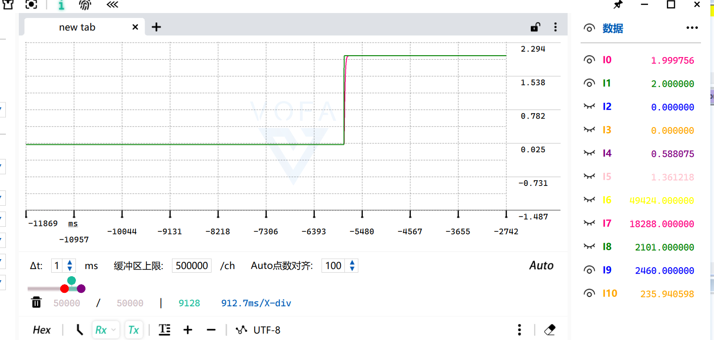
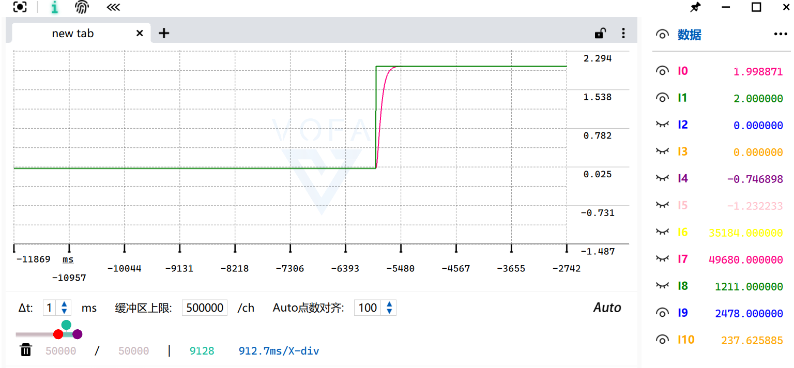

# 微分跟踪器（TD）：Vq 软启动 + 定点化

> 记录日期：2026-10-13
> 硬件：STM32F103（Cortex-M3，**无 FPU**）、Udc=12V、FOC 10.204kHz
> 相关代码：`myapp/TdTrakcer.c/.h`（新增）、`myapp/scheduler.c/.h`、`myapp/Motor_Config.h`、`myapp/Vofa.c`
> 结论一句话：把二阶线性跟踪微分器移植过来做 **Vq 命令的软启动**，并用 Q16/Q20 定点把它的
> CPU 占用从 **12.8% 降到 0.45%**（28 倍）；过程中还挖出"改了参数没反应"的**三个**原因。

---

## 1. 它是什么

二阶线性 TD（临界阻尼）：

$$\ddot y = \omega_n^2(u-y) - 2\omega_n \dot y$$

- 稳态时 `ÿ = ẏ = 0` → **`y = u`** → 输出是输入的**平滑版本** ✓
- `ẏ` 白送一阶导 ✓（将来速度环可当前馈/D 项用）
- `ωn` 越大跟得越快；本工程用来做**Vq 的软启动**（避免电压阶跃 → 电流冲击）

**离散化时把 Ts 吸收进系数**，运行时只剩乘加：

```
ẏ += K1·(u−y) − K2·ẏ        K1 = ωn²·Ts
 y += K3·ẏ                   K2 = 2·ωn·Ts , K3 = Ts
```

---

## 2. 定点化：Q16 状态 + Q20 系数

| 量 | 格式 | 说明 |
|---|---|---|
| `y`、`y_dot` | **Q16** int32 | 电压 × 65536 |
| `K1/K2/K3` | **Q20** int32 | 让 0.98ms 这种小 Ts 也有足够精度 |

```c
err = u_q16 - state->y;
state->y_dot += (int32_t)(((int64_t)state->K1 * err)           >> 20)
              - (int32_t)(((int64_t)state->K2 * state->y_dot) >> 20);
state->y     += (int32_t)(((int64_t)state->K3 * state->y_dot) >> 20);
```

**数值等价性已验证**（输入 2.0V，ωn=100，Ts=0.98ms）：

| t | 浮点版 | Q16 定点版 |
|---|---|---|
| 9.8 ms | 0.58 | **0.58** ✓ |
| 19.6 ms | 1.21 | **1.21** ✓ |
| 51 ms | 1.92 | **1.92** ✓ |
| 100 ms | 2.00 | **2.00** ✓ |

---

## 3. CPU 占用：12.8% → 0.45%

**从反汇编数出来的真实代价**（不是估算）：

| 函数 | 指令 | 软浮点调用 | 约 cycle |
|---|---|---|---|
| `TdTrakcer_Update_Q16`（定点内核） | 22 | **0** ✓ | **29** ✓ |
| `TdTrakcer_UpData`（含浮点转换的外层） | 30 | 4 | ~319 |
| `TdTrakcer_Param_Init` | 38 | 10 | ~750（只在上电跑一次 ✓）|

**改之前**：浮点版 @10kHz = 12 次软浮点调用 ≈ **900 cycle/次** → 每秒 918 万 cycle → **占 72MHz 的 12.8%** ✗

**改之后**（两招并用）：

| 措施 | 效果 |
|---|---|
| ① **分频到 1kHz**（`TD_DIV=10`）| TD 极点只有 ωn≈20rad/s → 10kHz 和 1kHz 跑**响应完全一样** ✗ → 省 10 倍 |
| ② **Q16 定点内核** | 900 → 319 cycle（其中 290 是给浮点调试接口的转换费）|
| **合计** | **319 × 1020Hz = 32.5 万 cycle/s = 占 CPU 0.45%** ✓✓ |

CpuStat 预期：load **28.9% → ~29.4%**（改之前会到 ~39% ✗）

---

## 4. ⚠️ 最有价值的一条：为什么"改 ωn 没效果"

现场踩了三个坑，**每一个单独都足以让人觉得"参数是死的"** ✗：

### ① 真 bug：系数只在初始化时算一次 ✗

```c
Param_Init():  K1 = f(ωn, Ts);     /* 只在上电算一次 */
Update():      只用 K1/K2/K3;      /* 根本不读 Omega_n ✗✗ */
```

→ 运行时改 `Omega_n` **对代码零影响** ✗

**已修** ✓：`UpData` 里每 128 拍（≈125ms）检查一次参数，变了就重算（浮点比较太贵，所以不是每拍查）：

```c
static uint8_t chk_cnt = 0;
if(++chk_cnt >= 128U){
    chk_cnt = 0;
    if((state->Omega_n != state->Wn_Last) || (state->Ts != state->Ts_Last))
        TdTrakcer_Recalc(state);
}
```

### ② 稳态下 ωn 本来就没有影响 ✗（不是 bug）

ωn=100 时 ~66ms 就到位了，之后改 ωn 输出**一动不动** ✓
**所以调参必须重新给一次阶跃** ✓（`Input` 归零 → 再给目标）

### ③ 不要在过渡过程中改 ωn ✗

仿真对比（第 30 拍把 100 改成 20）：

| t | ωn=100 一直 | 中途改成 20 |
|---|---|---|
| 49 ms | 1.905 | **2.005** ✗ |
| 78 ms | 1.990 | **2.228** ✗✗ 超调 12% |
| 392 ms | 2.000 | 2.004 ✓ |

原因：改 ωn 时 `ẏ` 还很大，阻尼项 `2ωn·ẏ` 突然变小 → 冲过头 ✓
**正确顺序：稳定 → 改 ωn → Input 归零 → 再给目标** ✓

---

## 5. ωn 怎么选（上升时间表）

临界阻尼二阶系统：**上升(10~90%) ≈ 3.36 / ωn**

| ωn (rad/s) | 上升(10~90%) | 到位(99%) |
|---|---|---|
| 5 | 672 ms | 1.3 s |
| **10** | 336 ms | 660 ms |
| **20（最终采用）** | **168 ms** | 330 ms |
| 30 | 112 ms | 220 ms |
| 50 | 67 ms | 132 ms |
| 100（一开始误用 ✗）| 34 ms | 66 ms |
| 300 | 11 ms | 22 ms |

> **我的判断错误**：一开始把 ωn=10 判为"太慢"✗，提到了 100。那是按**速度滤波器**在看；
> 但这里的用途是 **Vq 软启动**，0.2~0.3s 才是对的 ✓ 最终定为 **20**（168ms）。

**约束**：`ωn·Ts < 1` 才稳（显式欧拉）
- 1kHz 下 `ωn ≤ 500` 保守 ✓
- 10kHz 下可以到 5000 ✓

---

## 6. 实测效果





VOFA 通道（用户自己配的）：
- `[0]` = `Foc.Vq` → **实际输出电压（TD 的输出）** ✓ 平滑
- `[1]` = `Td_Track_Uq.Input` → **目标输入** ✓ 阶跃

**绿线阶跃、粉线平滑跟随、无超调** ✓ = 临界阻尼正常工作 ✓

---

## 7. 其他改动

| 项 | 内容 |
|---|---|
| **文件编码** | `TdTrakcer.c/.h` 原来是 **GBK** ✗（工程其他文件是 UTF-8）→ 已转 UTF-8 ✓ |
| **状态清零** | `Param_Init` 原来不清 `y/y_dot` ✗（靠全局变量零初始化侥幸正确）→ 已补 ✓ |
| **`Vd` 不再每周期强制 0** | 改到 `Init` 里设一次 ✓ → KEY2 重新有效 ✓ |
| **`y_dot_f` 不常驻** | 否则每次多 2 次软浮点（140 cycle）→ 需要时在 Watch 里写 `(float)y_dot/65536.0f` ✓ |

---

## 8. 遗留

1. **`y_dot` 还没用起来** ✓ → 将来速度环可直接用它当前馈（TD 白送的）
2. **1kHz 的 TS 必须跟着 TD_DIV 变** ✓（`TD_TS = FOC_TS * TD_DIV` ✓）
3. 想要真正做到 10kHz 跑也不心疼 → 直接调 `TdTrakcer_Update_Q16()`（29 cycle ✓）
